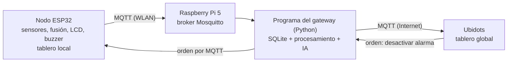

# Plan de trabajo — Challenge #3 · Equipo 7

## Estado al 09/11/2026

- Digital: firmware MQTT (conexión, telemetría, alertas, orden), gateway con SQLite, cola hacia Ubidots, órdenes y módulo de IA terminados y probados (24 pruebas del firmware y 25 del gateway); Ubidots configurado y probado con datos reales (tablero, desactivación desde la nube y correos de alerta); guías, protocolo de pruebas físicas y Wiki en borrador.
- Digital cerrado: tareas 10, 30 y 37 hechas (Wokwi con `tMqtt` activa: reconexión automática, tablero iniciado y ciclo estable; registro en `tests/datos/simulacion/tarea-mqtt-activa.log`).
- Bloqueado por hardware: prueba del ESP32 real con MQTT, instalación de la Raspberry Pi y todas las pruebas físicas (tareas 39 a 59).
- Wiki: completa en local (todas las páginas del Ch3 escritas). Los datos que faltan van entre corchetes y los llena Majo: porcentaje de uso de IA (7.1), reparto (6.1 y 6.2), acta 5 (6.3), RAM y precios de la Raspberry Pi (2.7 y 2.9), enlace del video (Home) y resultados físicos (4.10, 4.8, 4.9 y 5.2).
- Push del 09/11: Repo y Wiki publicados en GitHub; los datos entre corchetes se llenan directamente en la Wiki.

## 1. Arquitectura del Ch3

## 2. Requerimientos del enunciado

| # | Requerimiento (enunciado del Ch3) | Qué hay del Ch2 | Qué falta |
| :--- | :--- | :--- | :--- |
| R1 | Acceso al tablero desde un navegador (computador o celular) en la WLAN de la zona y desde cualquier parte de Colombia | Tablero local en la WLAN | Tablero global en Ubidots |
| R2 | El tablero muestra valor actual, histórico reciente y alertas; envía notificaciones y permite desactivar la alarma física | Hecho en el tablero local | Lo mismo en el tablero global, incluida la desactivación |
| R3 | Tablero local en un servidor web embebido en la WLAN e integrado con una plataforma IoT en la nube | Servidor embebido en el ESP32 | Integración con Ubidots |
| R4 | Acceso a los dos tableros (local y global) solo para usuarios autorizados | Digest + token + subred en el local | Usuarios autorizados en Ubidots; probar el filtro de subred en la WLAN real |
| R5 | Todos los datos del nodo viajan por MQTT a un gateway, donde se guardan en una base de datos y se procesan localmente antes de ir a la nube | No existe | Cliente MQTT en el ESP32; gateway con SQLite y procesamiento |
| R6 | El gateway se comunica con la plataforma IoT por MQTT | No existe | Reenvío del gateway a Ubidots por MQTT |
| R7 | Módulo de IA que genere predicción, detección de anomalías o recomendación para las autoridades, con su uso justificado | No existe | Diseño, implementación, evaluación y justificación |
| R8 | Microcontrolador + Raspberry Pi como gateway; sensores y actuadores validados con el docente; medición y transmisión en ISR o hilos independientes; base de datos local (se recomienda SQLite) | ESP32 con FreeRTOS; medición en tarea propia | Transmisión MQTT en su propia tarea; Raspberry Pi; SQLite |
| R9 | Se recomienda Mosquitto como broker local y Ubidots como plataforma en la nube | No existe | Instalar y configurar ambos |
| R10 | Notificación in situ: alarma física y visualización en tiempo real en el dispositivo | Buzzer y LCD 20×4 | Validar con el hardware montado |
| R11 | Integración funcional de todo, demostrada: adquisición → procesamiento → almacenamiento → MQTT → visualización local y global → alertas → IA | Parcial (solo el nodo) | Prueba de extremo a extremo con el prototipo físico |
| R12 | Pregunta guía: nivel y/o caudal, evaporación potencial y variables meteorológicas (radiación solar, temperatura, humedad, presión) combinadas con lógica de fusión | Nivel, VPD, ET0, T, HR, P, UV y fusión con histéresis | Mantener; aclarar en la Wiki que el GUVA-S12SD mide solo radiación UV |

## 3. Decisiones de diseño (aprobadas el 29/10)

Detalle en `Repo/docs/diseno/`.

| Decisión | Resultado | Documento |
| :--- | :--- | :--- |
| Nombres de los tópicos MQTT | Estructura del refuerzo 2.3: telemetría con QoS 0, alerta con QoS 1, estado `online`/`offline` retenido con última voluntad, orden `cmd/desactivar_alarma` con QoS 1 y respuesta del nodo en `cmd/respuesta` | `comunicacion-mqtt.md` |
| Cada cuánto publica el ESP32 | Telemetría cada 5 s hacia el gateway y la alerta en cada cambio de estado; el gateway envía a Ubidots promedios cada 5 min y los cambios de estado al instante (≈ 3 220 de los 4 000 datos diarios de la cuenta STEM) | `comunicacion-mqtt.md` |
| Qué procesa el gateway antes de enviar a la nube | Validación por rango de cada sensor, promedios de 5 min, conteo de mensajes perdidos, ET0 diaria, cola de envío y registro de órdenes; la fusión y la alarma siguen en el ESP32 | `gateway.md` |
| Qué hace el módulo de IA | Predicción de horas hasta el nivel crítico (regresión con intervalo), detección de anomalías (Isolation Forest y reglas físicas) y recomendación en texto con Gemini, que solo redacta a partir de esos resultados | `modulo-ia.md` |
| Seguridad de MQTT | Usuario y clave por cliente, sin acceso anónimo y con permisos por tópico en Mosquitto; TLS hacia Ubidots; el enlace ESP32 → Raspberry Pi va sin TLS (limitación documentada) | `gateway.md` |
| Cuenta de Ubidots | STEM (gratuita): 3 dispositivos, 10 variables por dispositivo, 1 tablero de 10 widgets; tablero solo con inicio de sesión y notificaciones por correo | `comunicacion-mqtt.md` |

## 4. Tareas detalladas

Solución y dónde está: qué se hizo y dónde está la evidencia. Las rutas son del repositorio (`Repo/`); «Wiki x.y» es la página de la Wiki; FIS-xx es la prueba de `tests/protocolo-fisico.md`. En las tareas físicas sin hacer indica la guía o la plantilla que ya está lista.
Tipo: Digital = se hace en el computador · Físico = necesita el hardware o la Raspberry Pi · Gestión = coordinación o entrega.
En las tareas hechas, la columna Encargado indica quiénes las hicieron; en las pendientes, la columna Encargado sugerido es una propuesta para discutir en equipo, con la carga repartida de forma pareja: Simón, lo físico (Raspberry Pi, montaje, pruebas y mediciones); Majo, el diseño y la Wiki; Pablo, el firmware MQTT, el gateway, Ubidots y la base del módulo de IA.

### 4.1. Diseño y decisiones

| # | Tarea | Req. | Tipo | Fecha límite | Encargado | Criterio | Estado | Solución y dónde está |
| :--- | :--- | :--- | :--- | :--- | :--- | :--- | :--- | :--- |
| 1 | Decidir los nombres de los tópicos MQTT, su QoS, cuáles son retenidos y el mensaje de última voluntad | R5, R6 | Digital | 31/10 | Majo | Hay una tabla de tópicos aprobada | Hecho | Cinco tópicos `sabana/chia/chia-01/...` con QoS, retenido y última voluntad, más `cmd/respuesta`. `docs/diseno/comunicacion-mqtt.md` (secciones 2 y 3); Wiki 2.5.6 |
| 2 | Revisar los límites de la cuenta de Ubidots y fijar cada cuánto publica el ESP32 | R6, R9 | Digital | 31/10 | Majo | La frecuencia está decidida y cabe en la cuenta | Hecho | Cuenta STEM: 4 000 datos/día y 1 petición/s. Telemetría cada 5 s al gateway y promedios de 5 min a Ubidots (≈ 3 220 datos/día). `docs/diseno/comunicacion-mqtt.md` (secciones 4, 5 y 7); Wiki 2.5.8 |
| 3 | Decidir qué cálculos hace el gateway antes de enviar a la nube | R5 | Digital | 31/10 | Majo | Lista de cálculos aprobada | Hecho | Validación por rango, promedios de 5 min, mensajes perdidos, ET0 diaria, cola y órdenes. `docs/diseno/gateway.md` (secciones 1 y 2); Wiki 2.5.7 |
| 4 | Elegir qué hará el módulo de IA y escribir por qué es pertinente para el problema | R7 | Digital | 31/10 | Majo | Enfoque y justificación aprobados | Hecho | Predicción de horas hasta el nivel crítico, anomalías con Isolation Forest y reglas, y recomendación en texto. `docs/diseno/modulo-ia.md` (secciones 2 y 3); Wiki 2.5.9 |
| 5 | Diseñar las tablas de la base SQLite (mediciones, alertas, órdenes recibidas, resultados de la IA) | R5, R8 | Digital | 31/10 | Majo | Esquema de tablas aprobado | Hecho | Ocho tablas en SQL. `docs/diseno/gateway.md` (sección 3); `gateway/gateway/db.py`; Wiki 2.5.7 |
| 6 | Definir usuarios, claves y permisos por tópico de Mosquitto, y el uso de TLS hacia Ubidots | R4 | Digital | 31/10 | Majo | Lista de usuarios y permisos aprobada | Hecho | Usuarios `nodo-chia-01`, `gw-chia` y `monitor` con ACL, sin anónimos; Ubidots por 8883 con TLS. `docs/diseno/gateway.md` (sección 4); `gateway/despliegue/mosquitto/` |
| 7 | Confirmar con el docente los sensores, actuadores y la Raspberry Pi que se usarán | R8 | Gestión | 31/10 | Simón | Confirmación del docente | Hecho | Confirmado; la Raspberry Pi 5 es un kit de la universidad |
| 8 | Dibujar el diagrama de bloques nuevo (hardware y software) con el gateway y la nube | R3, R11 | Digital | 31/10 | Majo | Diagrama revisado por integrantes del equipo | Hecho | Diagramas Mermaid de hardware y software. `docs/diseno/arquitectura.md`; Wiki 2.4.8 |

### 4.2. Firmware del ESP32: envío por MQTT

| # | Tarea | Req. | Tipo | Fecha límite | Encargado | Criterio | Estado | Solución y dónde está |
| :--- | :--- | :--- | :--- | :--- | :--- | :--- | :--- | :--- |
| 9 | Agregar al firmware una tarea FreeRTOS nueva, solo para MQTT, separada de la medición | R5, R8 | Digital | 03/11 | Majo y Pablo | Compila sin advertencias y el ciclo de 1 s no cambia | Hecho | Tarea `tMqtt` (núcleo 0, prioridad 1, 4 096 B). Wokwi: 86 ciclos, desviación máx. 0.051 ms. `firmware/src/tareas.cpp`; `tests/datos/simulacion/tarea-mqtt-vacia.log` |
| 10 | Conectar el ESP32 al broker con usuario y clave, reconectar solo si se cae, y publicar `offline` como última voluntad | R4, R5 | Digital | 03/11 | Majo y Pablo | En simulación se reconecta solo al cortar el broker | Hecho | Cliente MQTT de ESP-IDF con reconexión automática y `offline` como última voluntad. Wokwi: 5 reintentos automáticos sin afectar el ciclo. `firmware/src/mqtt.cpp`; `tests/datos/simulacion/tarea-mqtt-activa.log` |
| 11 | Publicar las mediciones (nivel, tendencia, temperatura, humedad, presión, UV, VPD y estado) en JSON cada N segundos | R5 | Digital | 03/11 | Majo y Pablo | Los mensajes llegan al broker con el formato acordado | Hecho | JSON cada 5 s con QoS 0. `firmware/src/mensajes_mqtt.cpp` y `mqtt.cpp`; pruebas en `firmware/test/test_mensajes_mqtt/` |
| 12 | Publicar un mensaje de alerta cada vez que cambia el estado (NORMAL, ADVERTENCIA, ALERTA, CRÍTICO, FALLA NIVEL) | R2, R5 | Digital | 03/11 | Majo y Pablo | Cada cambio de estado genera un mensaje | Hecho | Alerta con QoS 1 en cada cambio de estado. `firmware/src/mqtt.cpp`; Wiki 2.5.6 |
| 13 | Recibir por MQTT la orden de desactivar la alarma y aplicarla con las mismas reglas del tablero local (solo en ALERTA o CRÍTICO, con rearme) | R2 | Digital | 04/11 | Majo y Pablo | La orden silencia el buzzer solo cuando corresponde | Hecho | Suscripción a `cmd/desactivar_alarma`; solo en ALERTA o CRÍTICO; respuesta en `cmd/respuesta`. `firmware/src/mqtt.cpp`; Wiki 2.5.6 |
| 14 | Escribir pruebas unitarias del formato JSON y de la orden de desactivar | R11 | Digital | 04/11 | Majo y Pablo | Pruebas superadas en el computador | Hecho | 8 pruebas de `mensajes_mqtt` (24 de 24 en el firmware). `firmware/test/test_mensajes_mqtt/`; Wiki 3.3 |
| 15 | Probar en Wokwi que el ESP32 simulado publica en un broker de prueba (resultado marcado como SIMULACIÓN) | R5 | Digital | 04/11 | Pablo | Registro de la simulación guardado | Reemplazada por la 45 | Wokwi no alcanza un broker; se valida con el ESP32 real (45). Registro de Wokwi con el cliente activo: `tests/datos/simulacion/tarea-mqtt-activa.log` |

### 4.3. Programa del gateway (se desarrolla en el computador y se copia a la Raspberry Pi)

| # | Tarea | Req. | Tipo | Fecha límite | Encargado | Criterio | Estado | Solución y dónde está |
| :--- | :--- | :--- | :--- | :--- | :--- | :--- | :--- | :--- |
| 16 | Instalar Mosquitto en el computador para desarrollar sin la Raspberry Pi | R9 | Digital | 01/11 | Majo y Pablo | El broker local recibe mensajes de prueba | Hecho | Mosquitto 2.1.2 en el computador (servicio de Windows); publicar y suscribirse probado |
| 17 | Escribir un publicador de prueba en Python que imite al ESP32 | R5 | Digital | 02/11 | Majo y Pablo | Publica mensajes con el formato acordado | Hecho | `gateway/herramientas/publicador_prueba.py` (escenarios normal y descenso, alertas, orden, última voluntad) |
| 18 | Programa en Python que se suscribe a los tópicos del nodo y guarda cada mensaje en SQLite | R5, R8 | Digital | 04/11 | Majo y Pablo | Todos los mensajes de prueba quedan en la base | Hecho | `gateway/gateway/registro.py` y `db.py`. 70 telemetrías y 2 alertas registradas: `tests/datos/gateway/integracion-publicador.log` |
| 19 | Agregar al programa el procesamiento local: validación de rangos, promedios y ET0 diaria | R5 | Digital | 05/11 | Majo y Pablo | Los valores procesados se guardan y coinciden con un cálculo a mano | Hecho | `gateway/gateway/validacion.py` y `procesamiento.py`; comparado con FAO-56 en `gateway/tests/test_gateway.py`; Wiki 2.5.7 |
| 20 | Enviar los datos procesados a Ubidots por MQTT con TLS | R6 | Digital | 06/11 | Majo y Pablo | Los datos aparecen en Ubidots | Hecho | `gateway/gateway/nube.py` (MQTT con TLS). 10 cargas confirmadas: `tests/datos/gateway/ubidots-conexion.log` |
| 21 | Guardar en cola lo que no se pudo enviar cuando falla Internet y enviarlo al volver | R5, R6 | Digital | 06/11 | Majo y Pablo | Al cortar Internet no se pierde ningún dato | Hecho | Tabla `cola_nube`. Sin Internet: 12 cargas en cola, 0 perdidas; al volver, 13 de 13 enviadas en orden en 20 s. `tests/datos/gateway/cola-corte-internet.md`; Wiki 4.10.3 |
| 22 | Recibir desde Ubidots la orden de desactivar la alarma, reenviarla al ESP32 y registrarla en SQLite (cuándo y desde dónde) | R2 | Digital | 07/11 | Majo y Pablo | La orden llega al publicador de prueba y queda registrada | Hecho | `gateway/gateway/ordenes.py`. 2 órdenes aceptadas desde el interruptor: `tests/datos/gateway/ubidots-orden.log` |
| 23 | Escribir pruebas automáticas del gateway (pytest) | R11 | Digital | 07/11 | Majo y Pablo | Pruebas superadas | Hecho | 25 pruebas con pytest (16 del gateway y 9 de IA). `gateway/tests/`; Wiki 3.3.7 |
| 24 | Configurar Mosquitto: usuarios con clave, permisos por tópico y sin acceso anónimo | R4 | Digital | 07/11 | Majo y Pablo | Un cliente sin clave es rechazado | Hecho | `gateway/despliegue/mosquitto/` (gateway.conf y acl). 7 de 7 casos: `tests/datos/gateway/mosquitto-acl.md` |
| 25 | Crear el servicio para que el gateway arranque solo al encender la Raspberry Pi | R11 | Digital | 08/11 | Majo y Simón | Archivo del servicio en el repositorio, sin secretos | Hecho | `gateway/despliegue/gateway.service` (systemd); instalación en Guía `docs/guias/raspberry-pi.md` |

### 4.4. Tablero global en Ubidots

| # | Tarea | Req. | Tipo | Fecha límite | Encargado | Criterio | Estado | Solución y dónde está |
| :--- | :--- | :--- | :--- | :--- | :--- | :--- | :--- | :--- |
| 26 | Crear la cuenta, el dispositivo y las variables en Ubidots | R3, R9 | Digital | 02/11 | Majo y Pablo | El dispositivo recibe datos de prueba | Hecho | Dispositivos `chia-01` y `gw-chia` con sus variables. `docs/guias/ubidots.md`; `docs/capturas/ubidots/ubidots-dispositivos.png` |
| 27 | Armar el tablero: valores actuales, gráficas del histórico y estado de alerta | R1, R2 | Digital | 08/11 | Majo y Pablo | Tablero con todas las variables | Hecho | 10 widgets. `docs/capturas/ubidots/ubidots-tablero-global.png`; Wiki 2.5.8 |
| 28 | Configurar notificaciones (correo u otro medio) cuando el estado pasa a ALERTA o CRÍTICO | R2 | Digital | 08/11 | Majo y Pablo | Llega una notificación de prueba | Hecho | Dos eventos con correo; 3 de 3 correos recibidos. `tests/datos/gateway/ubidots-notificaciones.md`; `docs/capturas/ubidots/` |
| 29 | Agregar el botón de desactivar la alarma, que envía la orden por MQTT al gateway | R2 | Digital | 08/11 | Majo y Pablo | El gateway recibe la orden | Hecho | Interruptor sobre `gw-chia/desactivar_alarma`. `tests/datos/gateway/ubidots-orden.log`; Wiki 2.5.8 |
| 30 | Restringir el tablero a usuarios autorizados (revisar qué permite la cuenta) | R4 | Digital | 08/11 | Majo | Un usuario sin permiso no puede ver ni operar el tablero | Hecho | Acceso solo con inicio de sesión; sin enlace público (la cuenta STEM no tiene gestión de usuarios). Wiki 2.5.8 |
| 31 | Mostrar en el tablero los resultados del módulo de IA | R7 | Digital | 11/11 | Majo y Pablo | La predicción o recomendación aparece en el tablero | Hecho | `horas_hasta_critico`, `anomalia` y `recomendacion` en `gw-chia`. Captura del tablero; Wiki 2.5.8 y 2.5.9 |

### 4.5. Módulo de inteligencia artificial

| # | Tarea | Req. | Tipo | Fecha límite | Encargado | Criterio | Estado | Solución y dónde está |
| :--- | :--- | :--- | :--- | :--- | :--- | :--- | :--- | :--- |
| 32 | Reunir datos para construir y evaluar el modelo: registros del Ch2, datos de SQLite y series del IDEAM | R7 | Digital | 06/11 | Majo y Pablo | Conjunto de datos guardado y descrito | Hecho | Datos sintéticos de respuesta conocida (`gateway/herramientas/evaluar_ia.py`); los datos medidos salen de la prueba de 24 h (57). `tests/datos/ia/evaluacion-sintetica.md` |
| 33 | Implementar la predicción de cuántas horas faltan para el nivel crítico según la tendencia | R7 | Digital | 09/11 | Majo y Pablo | Predicción calculada y guardada en SQLite | Hecho | Regresión lineal con IC del 95 % sobre 24 h. `gateway/gateway/ia/prediccion.py`; Wiki 2.5.9 |
| 34 | Implementar la detección de anomalías (descensos anómalos, valores imposibles de un sensor) | R7 | Digital | 09/11 | Majo y Pablo | Las anomalías de prueba se detectan | Hecho | Reglas e Isolation Forest con la hora del día (contaminación 0.05). `gateway/gateway/ia/anomalias.py`; Wiki 2.5.9 |
| 35 | (Opcional) Generar la recomendación en texto con una API de IA generativa, con alternativa si no hay Internet | R7 | Digital | 10/11 | Majo | Recomendación generada; la clave de la API no está en el repositorio | Hecho | Recomendación por reglas; Gemini implementado pero desactivado (sin clave). `gateway/gateway/ia/recomendacion.py`; `.env.example` |
| 36 | Evaluar el módulo con una métrica de error y escribir su justificación técnica | R7 | Digital | 11/11 | Majo | Tabla de resultados con la métrica | Hecho | Predicción: error de 0.10 h y 4.2 h. Anomalías: P 0.82, R 0.83. `tests/datos/ia/evaluacion-sintetica.md`; `docs/diseno/modulo-ia.md`; Wiki 2.5.9 |

### 4.6. Tablero local (ya existe desde el Ch2)

| # | Tarea | Req. | Tipo | Fecha límite | Encargado | Criterio | Estado | Solución y dónde está |
| :--- | :--- | :--- | :--- | :--- | :--- | :--- | :--- | :--- |
| 37 | Comprobar que el tablero local sigue funcionando igual con la tarea MQTT agregada | R3 | Digital | 04/11 | Majo y Pablo | Tablero en vivo y ciclo de 1 s estable en simulación | Hecho | Wokwi con `tMqtt` activa: servidor y tablero iniciados, ciclo estable (71 ciclos, 0.051 ms). `tests/datos/simulacion/tarea-mqtt-activa.log` |
| 38 | (Opcional) Mostrar en el tablero local el estado de la conexión MQTT y la predicción de la IA | R2, R7 | Digital | 11/11 | Majo y Pablo | Se ve en el tablero | Hecho | «Gateway: conectado / sin conexión» en el encabezado (campo `mqtt`). `firmware/data/index.html` y `tablero.js`; Wiki 2.5.4 |

### 4.7. Raspberry Pi 5

| # | Tarea | Req. | Tipo | Fecha límite | Encargado | Criterio | Estado | Solución y dónde está |
| :--- | :--- | :--- | :--- | :--- | :--- | :--- | :--- | :--- |
| 39 | Grabar Raspberry Pi OS Lite (64 bits) en la microSD con Raspberry Pi Imager, configurando ahí Wi-Fi, usuario y SSH | R8 | Físico | 02/11 | Simón | La microSD está lista | | Pasos en Guía `docs/guias/raspberry-pi.md` |
| 40 | Encender la Raspberry Pi, entrar por SSH desde el computador y actualizar el sistema | R8 | Físico | 02/11 | Simón | Conexión por SSH funcionando | | Pasos en Guía `docs/guias/raspberry-pi.md` |
| 41 | Instalar Mosquitto, Python y SQLite en la Raspberry Pi | R8, R9 | Físico | 05/11 | Simón | Los tres programas responden | | Pasos en Guía `docs/guias/raspberry-pi.md` |
| 42 | Conectar la Raspberry Pi al punto de acceso del celular y comprobar su nombre `gateway-chia.local` (el ESP32 la busca por nombre; no se fija la IP) | R5 | Físico | 05/11 | Simón | `avahi-daemon` activo y el ESP32 encuentra `gateway-chia.local` | | Pasos en Guía `docs/guias/raspberry-pi.md` |
| 43 | Copiar el programa del gateway y la configuración de Mosquitto, y activar el arranque automático | R5, R11 | Físico | 08/11 | Simón | Tras reiniciar la Raspberry Pi, el gateway funciona solo | | Pasos en Guía `docs/guias/raspberry-pi.md`; archivos en `gateway/despliegue/` |

### 4.8. Hardware e integración física

| # | Tarea | Req. | Tipo | Fecha límite | Encargado | Criterio | Estado | Solución y dónde está |
| :--- | :--- | :--- | :--- | :--- | :--- | :--- | :--- | :--- |
| 44 | Revisar que el montaje del Ch2 funciona: escáner I2C, cada sensor, LCD y buzzer | R10 | Físico | 05/11 | Simón | Todos los sensores en OK en el registro serie | | FIS-01 en `tests/protocolo-fisico.md`; CSV `tests/datos/fisico/fis01-montaje.csv` |
| 45 | Grabar el firmware con MQTT en el ESP32 real | R5 | Físico | 06/11 | Simón | El ESP32 real publica en el broker de la Raspberry Pi | | Pasos en `docs/guias/prueba-esp32-mqtt.md` |
| 46 | Integrar la Raspberry Pi al montaje (ubicación, alimentación, carcasa) | R8 | Físico | 12/11 | Simón | Prototipo integrado | | Esquema de conexión en Wiki 2.7.6 |
| 47 | Tomar fotos del prototipo y del montaje, y dibujar el esquemático real con la Raspberry Pi | R11 | Físico | 12/11 | Simón | Fotos y esquemático listos para la Wiki | | Espacio para fotos en Wiki 4.10.4; esquema en 2.7.6 |

### 4.9. Banco de pruebas con el prototipo físico

| # | Tarea | Req. | Tipo | Fecha límite | Encargado | Criterio | Estado | Solución y dónde está |
| :--- | :--- | :--- | :--- | :--- | :--- | :--- | :--- | :--- |
| 48 | Prueba de 30 min: el ESP32 real publica y la Raspberry Pi guarda todo en SQLite sin pérdidas | R5, R11 | Físico | 08/11 | Simón | CSV con mensajes enviados y recibidos | | FIS-04 y FIS-05; CSV `tests/datos/fisico/fis05-mqtt.csv`; `tests/herramientas/latencias_gateway.py` |
| 49 | Calibrar el nivel contra una regla (5 niveles, 10 lecturas por nivel) | R12 | Físico | 10/11 | Simón | Tabla con error, repeticiones y desviación | | FIS-02; CSV `tests/datos/fisico/fis02-nivel.csv`; tabla en Wiki 4.10.2 |
| 50 | Comparar temperatura y humedad contra un termohigrómetro de referencia | R12 | Físico | 10/11 | Simón | Tabla con error, repeticiones y desviación | | FIS-03; CSV `tests/datos/fisico/fis03-th.csv` |
| 51 | Medir el tiempo desde que cambia el estado hasta que aparece en Ubidots | R1, R11 | Físico | 11/11 | Simón | Latencia medida con repeticiones | | FIS-07; CSV `tests/datos/fisico/fis07-latencia-nube.csv`; `tests/herramientas/latencias_gateway.py` |
| 52 | Medir el tiempo desde el botón de Ubidots hasta que se silencia el buzzer | R2, R11 | Físico | 11/11 | Simón | Latencia medida con repeticiones | | FIS-08; CSV `tests/datos/fisico/fis08-orden.csv` |
| 53 | Probar el acceso no autorizado: filtro de subred y claves en la WLAN real, y usuario no autorizado en Ubidots | R4 | Físico | 11/11 | Simón | Accesos rechazados, con registro | | FIS-09; CSV `tests/datos/fisico/fis09-acceso.csv` |
| 54 | Cortar la WLAN y medir cuánto tarda el sistema en recuperarse | R11 | Físico | 12/11 | Simón | Recuperación medida; la alarma in situ siguió funcionando | | FIS-10; CSV `tests/datos/fisico/fis10-wlan.csv` |
| 55 | Apagar el broker o reiniciar la Raspberry Pi y comprobar que el ESP32 se reconecta solo | R5 | Físico | 12/11 | Simón | Reconexión medida | | FIS-11; CSV `tests/datos/fisico/fis11-broker.csv` |
| 56 | Cortar Internet en la Raspberry Pi y comprobar que los datos se guardan y se envían al volver | R5, R6 | Físico | 12/11 | Simón | Ningún dato perdido | | FIS-12; CSV `tests/datos/fisico/fis12-internet.csv` (la cola ya se probó sin Internet en el computador: tarea 21) |
| 57 | Dejar el ecosistema completo funcionando 24 h o más y guardar los datos (también sirven para la IA) | R7, R11 | Físico | 14/11 | Simón | CSV de 24 h y sin reinicios | | FIS-13; carpeta `tests/datos/fisico/fis13-24h/` |
| 58 | Grabar los patrones del buzzer en cada estado | R10 | Físico | 12/11 | Simón | Audio o video por estado | | FIS-14; CSV `tests/datos/fisico/fis14-buzzer.csv` |
| 59 | Medir el consumo eléctrico del ESP32 y de la Raspberry Pi | R11 | Físico | 13/11 | Simón | Corriente medida por estado | | FIS-15; CSV `tests/datos/fisico/fis15-consumo.csv` |

### 4.10. Wiki

| # | Tarea | Req. | Tipo | Fecha límite | Encargado | Criterio | Estado | Solución y dónde está |
| :--- | :--- | :--- | :--- | :--- | :--- | :--- | :--- | :--- |
| 60 | Actualizar el Home: resumen, motivación, justificación y estructura para el Ch3 | Entregable 1 | Digital | 14/11 | Majo | Página revisada | Hecho | Wiki Home: resumen del Ch3, abstract en inglés, tablero global y video (marcador) |
| 61 | Actualizar requerimientos y restricciones (técnicas, económicas, regulatorias, de espacio, escalabilidad, temporales) | Entregable 2 | Digital | 05/11 | Majo | Páginas 2.1 y 2.2 revisadas | Hecho | Wiki 2.1 (RF-20 a RF-26, RNF-13 a RNF-15) y 2.2 |
| 62 | Actualizar la arquitectura con el diagrama de bloques de hardware y software | Entregable 2 | Digital | 05/11 | Majo | Página 2.4 revisada | Hecho | Wiki 2.4 (tarea `tMqtt` y 2.4.8 ecosistema) |
| 63 | Escribir páginas nuevas: comunicación MQTT, gateway y base de datos, tablero global, módulo de IA | Entregable 2 | Digital | 11/11 | Majo | Páginas revisadas | Hecho | Wiki 2.5.6 a 2.5.9 (páginas nuevas) |
| 64 | Diagramas UML de la solución y de cada módulo nuevo (secuencia MQTT, gateway, IA), en Mermaid | Entregable 2 | Digital | 11/11 | Majo | Diagramas en la Wiki | Hecho | Wiki 2.6.5 (secuencias), 2.6.6 (clases del gateway) y secuencia de la orden en 2.5.6 |
| 65 | Esquemático de hardware con la Raspberry Pi | Entregable 2 | Digital | 13/11 | Majo y Simón | Figura en la Wiki | Hecho | Wiki 2.7.6 (conexión y alimentación de la Raspberry Pi); falta la foto (47) |
| 66 | Estándares aplicados: MQTT, TLS y los del Ch2 | Entregable 2 | Digital | 11/11 | Majo | Página 2.8 revisada | Hecho | Wiki 2.8 (MQTT 3.1.1 y TLS 1.3) |
| 67 | Actualizar el modelo de negocio y la viabilidad con la Raspberry Pi, Ubidots y la API de IA | Entregable 2 | Digital | 11/11 | Majo | Páginas 2.9 y 2.10 revisadas | Hecho | Wiki 2.9 y 2.10; RAM y precios entre corchetes (los llena Majo) |
| 68 | Capítulo 4 con los resultados medidos y los CSV del banco de pruebas | Entregable 3 | Digital | 15/11 | Majo | Tablas con esperado, observado, error, repeticiones, desviación y CSV | Hecho | Wiki 4.10 (15 pruebas físicas, calibración y pruebas del ecosistema); los valores físicos salen de los CSV con `tests/herramientas/resumen_csv.py` |
| 69 | Autoevaluación del protocolo de pruebas | Entregable 4 | Digital | 15/11 | Majo | Página 4.9 revisada | Hecho | Wiki 4.9.6 |
| 70 | Conclusiones, retos, trabajo futuro y referencias IEEE (mayoría de los últimos 5 años) | Entregable 5 | Digital | 15/11 | Majo | Capítulo 5 y Referencias revisados | Hecho | Wiki 5.2.4, 5.3.9 a 5.3.12, 5.4, 5.5 y Referencias (35) |
| 71 | Anexos: código fuente documentado (firmware, gateway e IA) y esquemáticos | Entregable 6 | Digital | 15/11 | Majo | Página 9 con enlaces | Hecho | Wiki 9 (código, diseño, guías, pruebas, herramientas y capturas) |
| 72 | Roles, actividades y contribuciones de cada integrante | Entregable | Gestión | 15/11 | Majo | Páginas 6.1 y 6.2 revisadas | Hecho | Wiki 6.2 con las filas del Ch3; responsables entre corchetes (los llena Majo) |
| 73 | Actas de reunión y coevaluación | Entregable | Gestión | 15/11 | Equipo | Página 6.3 con actas firmadas | Hecho | Wiki 6.3, acta 5; fecha, participantes y reparto entre corchetes |
| 74 | Sección 7 de IA: qué IA se usó, instrucciones transcritas, cómo se validó y porcentaje de uso | Entregable | Digital | 15/11 | Majo | Página 7.1 completa | Hecho | Wiki 7.1 (porcentaje, uso por ámbito, transcripción, validación); porcentajes entre corchetes |
| 75 | Enlazar el video en la Wiki | Entregable 7 | Digital | 15/11 | Majo | Enlace funcionando | Hecho | Wiki Home con el marcador [enlace al video] (2 lugares); se llena al subir el video (78) |

### 4.11. Video, entrega y sustentación

| # | Tarea | Req. | Tipo | Fecha límite | Encargado | Criterio | Estado | Solución y dónde está |
| :--- | :--- | :--- | :--- | :--- | :--- | :--- | :--- | :--- |
| 76 | Escribir el guion del video (máximo 5 min) con la demostración de la validación | Entregable 7 | Digital | 12/11 | Majo | Guion aprobado | Hecho | `VIDEO_CHALLENGE3/00-GUION.md` (local) |
| 77 | Grabar el video con los tres integrantes en cámara | Entregable 7 | Físico | 14/11 | Equipo | Video de 5 min o menos | | Guion en `VIDEO_CHALLENGE3/00-GUION.md` |
| 78 | Subir el video de forma que se reproduzca en Teams sin descargarlo | Entregable | Gestión | 15/11 | Majo | Se reproduce en Teams | | |
| 79 | Renombrar el repositorio y comprobar que los enlaces de la Wiki siguen funcionando | Entregable | Gestión | 15/11 | Majo | Enlaces sin errores | | |
| 80 | Compartir la Wiki con @afbeltranp y verificar que el repositorio es público | Entregable | Gestión | 15/11 | Pablo | Acceso confirmado | | |
| 81 | Preparar el .zip con los archivos adicionales | Entregable | Gestión | 16/11 | Simón | .zip listo | | |
| 82 | Hacer la entrega en Teams (una sola por equipo) | Entregable | Gestión | 16/11 | Majo | Entrega confirmada | | |
| 83 | Preparar el pitch de 3 min (con parte en inglés, según la rúbrica de comunicación) | Sustentación | Gestión | 18/11 | Equipo | Pitch ensayado | Hecho | Pitch con parte en inglés en `SUSTENTACION_CH3.md` (local), sección 1 |
| 84 | Ensayar la demostración completa y tener un plan B de red (por ejemplo, un punto de acceso propio) | Sustentación | Físico | 18/11 | Simón | Demostración ensayada | Parcial | Plan B de red y lista previa en `SUSTENTACION_CH3.md`, sección 2; falta el ensayo con el hardware |
| 85 | Preparar respuestas a preguntas probables (MQTT, SQLite, IA, seguridad, fusión) | Sustentación | Gestión | 18/11 | Equipo | Lista de preguntas repasada | Hecho | 17 preguntas con respuesta corta y página de la Wiki en `SUSTENTACION_CH3.md`, sección 3 |

## 5. Calendario actualizado (09/11/2026)

| Fechas | Digital | Físico |
| :--- | :--- | :--- |
| 09/11 – 10/11 | Revisión de los borradores de la Wiki; datos de 7.1, 6.1, 6.2 y acta; push del Repo | Instalar la Raspberry Pi (39–43) y prueba del ESP32 real con MQTT (44–45), con las guías |
| 11/11 – 13/11 | Capítulo 4 a medida que lleguen los CSV; modelo de negocio con el precio de la Raspberry Pi (67) | Prueba de 30 min, calibración, escenarios de fusión, latencias, acceso y robustez (48–56, 58–59); fotos y esquemático (47) |
| 13/11 – 14/11 | Autoevaluación del protocolo (69), conclusiones y retos (70), sección 8 de mejoras frente al Ch2 | Prueba de 24 h (57) y grabación del video (77) |
| 15/11 | Revisión final de la Wiki (sin corchetes, enlaces, referencias, sin marcas de IA), enlace del video, push | Ensayo de la demostración |
| 16/11 | Entrega en Teams (79–82); desde ahí la Wiki no se modifica | — |
| 17/11 – 19/11 | Pitch y preguntas (83, 85) | Ensayo (84); sustentación el 19/11 |
