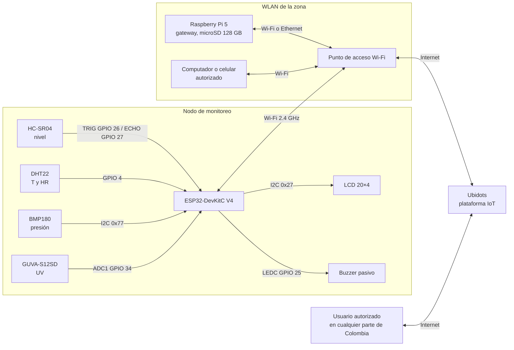
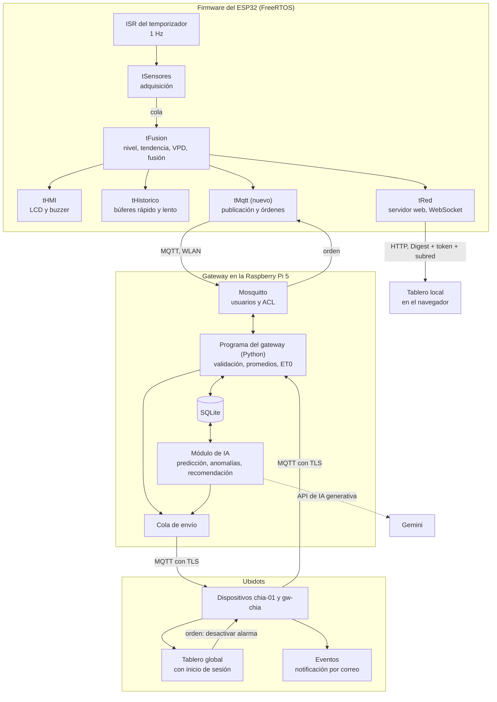

# Arquitectura del sistema — Challenge #3

Diagrama de bloques de hardware y de software del ecosistema completo. Diseño del 29/10/2026; los detalles están en
[comunicacion-mqtt.md](comunicacion-mqtt.md), [gateway.md](gateway.md) y [modulo-ia.md](modulo-ia.md).

## 1. Hardware

## 2. Software

## 3. Qué cambia frente al Challenge #2

| Bloque | Challenge #2 | Challenge #3 |
| :--- | :--- | :--- |
| Firmware | Cinco tareas; tablero local por HTTP y WebSocket | Tarea nueva `tMqtt`; el resto sin cambios |
| Comunicación | Sin MQTT | MQTT nodo → gateway → Ubidots |
| Almacenamiento | Búferes en RAM del ESP32 (se pierden al reiniciar) | Además, SQLite en el gateway |
| Tableros | Local en el ESP32 | Local en el ESP32 y global en Ubidots |
| Inteligencia artificial | — | Predicción, anomalías y recomendación en el gateway |
