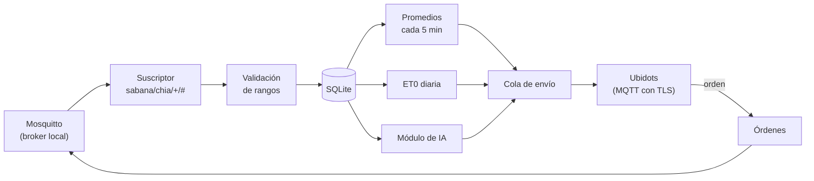

# Diseño del gateway — Challenge #3

Diseño del 29/10/2026. Define qué procesa el gateway (Raspberry Pi 5) antes de enviar a la nube, cómo guarda los datos en
SQLite y quién puede publicar o suscribirse en el broker Mosquitto. Los tópicos y los mensajes están en
[comunicacion-mqtt.md](comunicacion-mqtt.md).

## 1. Funciones del gateway



| Función | Qué hace | Por qué en el gateway |
| :--- | :--- | :--- |
| Registro | Guarda cada mensaje del nodo en SQLite con la hora de recepción | El enunciado exige almacenar en una base local antes de enviar a la nube; SQLite conserva el detalle completo, que Ubidots solo guarda 1 mes |
| Validación de rangos | Marca como inválido un valor fuera del rango del sensor (sección 2) y no lo usa en los promedios | Evita que una lectura imposible llegue al tablero global o al módulo de IA |
| Promedios cada 5 min | Media de los valores válidos de los ≈ 60 mensajes del periodo; estado de alerta más grave del periodo | Límite de 4 000 datos por día de Ubidots STEM |
| Pérdida de mensajes | Cuenta los saltos en el campo `id` de la telemetría | Mide la calidad del enlace nodo → gateway para el banco de pruebas |
| ET0 diaria | Hargreaves-Samani con la temperatura máxima y mínima del día guardadas en SQLite | El ESP32 pierde los extremos de 24 h al reiniciarse; el gateway los conserva en disco |
| Cola de envío | Guarda lo que no se pudo enviar a Ubidots y lo reenvía al volver Internet | Ningún dato se pierde si cae Internet |
| Órdenes | Recibe de Ubidots la orden de desactivar la alarma, la reenvía al nodo y registra la respuesta | Trazabilidad de quién dio la orden y si el nodo la aplicó |
| Módulo de IA | Predicción y detección de anomalías sobre el histórico de SQLite | Usa el histórico completo, que el ESP32 no guarda |

La fusión y la alarma in situ siguen en el ESP32: no dependen del gateway ni de la red.

## 2. Rangos de validación

Rango de medición de cada sensor según su hoja de datos; un valor fuera del rango se guarda, pero se marca como inválido.

| Variable | Rango válido | Fuente |
| :--- | :--- | :--- |
| Distancia del HC-SR04 (nivel derivado de ella) | 2 a 400 cm | Hoja de datos del HC-SR04 [6] |
| Nivel en % de la altura útil | 0 a 110 % (el 10 % adicional cubre el oleaje y la tolerancia de montaje) | Criterio de diseño |
| Temperatura del DHT22 | −40 a 80 °C | Hoja de datos del DHT22 [7] |
| Humedad relativa del DHT22 | 0 a 100 % | Hoja de datos del DHT22 [7] |
| Presión del BMP180 | 300 a 1 100 hPa | Hoja de datos del BMP180 [8] |
| Índice UV (aproximación del GUVA-S12SD) | 0 a 15 | Criterio de diseño: la escala de la OMS considera extremo un índice de 11 o más [15] |

Las referencias numeradas son las de la Wiki (página Referencias).

## 3. Base de datos SQLite

Archivo `gateway.db` en la Raspberry Pi. Horas en UTC con formato ISO 8601; `epoca_nodo` es la hora que envía el nodo (puede ser nula si no tiene NTP).

```sql
-- Cada mensaje de telemetría del nodo (uno cada 5 s).
CREATE TABLE telemetria (
    id                 INTEGER PRIMARY KEY,
    nodo               TEXT    NOT NULL,
    msg_id             INTEGER NOT NULL,          -- campo "id" del mensaje
    recibido_utc       TEXT    NOT NULL,
    epoca_nodo         INTEGER,
    ciclo              INTEGER,
    estado             TEXT    NOT NULL,
    causas             TEXT,                      -- arreglo JSON
    alarma_desactivada INTEGER NOT NULL,
    nivel_cm REAL, nivel_pct REAL, tend_cm_min REAL,
    t_c REAL, hr_pct REAL, p_hpa REAL, uv_idx REAL,
    vpd_kpa REAL, et0_mm_dia REAL,
    sensores           TEXT,                      -- objeto JSON con el estado de cada sensor
    rssi               INTEGER,
    invalidos          TEXT                       -- campos fuera de rango, separados por comas
);
CREATE INDEX ix_telemetria_nodo_tiempo ON telemetria (nodo, recibido_utc);

-- Cambios del estado de alerta (QoS 1: se descartan duplicados).
CREATE TABLE alertas (
    id           INTEGER PRIMARY KEY,
    nodo         TEXT    NOT NULL,
    msg_id       INTEGER NOT NULL,
    recibido_utc TEXT    NOT NULL,
    epoca_nodo   INTEGER,
    anterior     TEXT,
    estado       TEXT    NOT NULL,
    causas       TEXT,
    nivel_pct    REAL,
    tend_cm_min  REAL,
    UNIQUE (nodo, msg_id, epoca_nodo)
);

-- Conexión y desconexión del nodo (mensaje retenido y última voluntad).
CREATE TABLE conexion_nodo (
    id           INTEGER PRIMARY KEY,
    nodo         TEXT NOT NULL,
    recibido_utc TEXT NOT NULL,
    estado       TEXT NOT NULL CHECK (estado IN ('online', 'offline'))
);

-- Órdenes de desactivar la alarma y su resultado.
CREATE TABLE ordenes (
    orden_id      TEXT PRIMARY KEY,
    nodo          TEXT NOT NULL,
    origen        TEXT NOT NULL,                  -- 'ubidots'
    recibida_utc  TEXT NOT NULL,                  -- cuando llegó al gateway
    enviada_utc   TEXT,                           -- cuando se publicó al nodo
    respuesta_utc TEXT,
    resultado     TEXT CHECK (resultado IN ('aceptada', 'rechazada')),
    motivo        TEXT,
    estado_nodo   TEXT                            -- estado de alerta al aplicar la orden
);

-- Promedios de 5 min que se envían a Ubidots.
CREATE TABLE agregados_5min (
    id            INTEGER PRIMARY KEY,
    nodo          TEXT    NOT NULL,
    inicio_utc    TEXT    NOT NULL,
    fin_utc       TEXT    NOT NULL,
    n_mensajes    INTEGER NOT NULL,
    n_esperados   INTEGER NOT NULL,               -- 60 con telemetría cada 5 s
    nivel_cm REAL, nivel_pct REAL, tend_cm_min REAL,
    t_c REAL, hr_pct REAL, p_hpa REAL, uv_idx REAL, vpd_kpa REAL,
    estado_peor   TEXT,                           -- estado más grave del periodo
    UNIQUE (nodo, inicio_utc)
);

-- ET0 diaria calculada en el gateway.
CREATE TABLE et0_diaria (
    nodo        TEXT NOT NULL,
    fecha       TEXT NOT NULL,                    -- fecha local (America/Bogota)
    t_max_c     REAL NOT NULL,
    t_min_c     REAL NOT NULL,
    ra_mj_m2_d  REAL NOT NULL,
    et0_mm_dia  REAL NOT NULL,
    n_muestras  INTEGER NOT NULL,
    PRIMARY KEY (nodo, fecha)
);

-- Resultados del módulo de IA.
CREATE TABLE ia_resultados (
    id                   INTEGER PRIMARY KEY,
    nodo                 TEXT NOT NULL,
    calculado_utc        TEXT NOT NULL,
    horas_hasta_critico  REAL,                    -- nulo si el nivel no baja
    anomalia             INTEGER NOT NULL,        -- 0 o 1
    tipo_anomalia        TEXT,
    detalle              TEXT                     -- JSON con los datos usados
);

-- Mensajes pendientes de envío a Ubidots.
CREATE TABLE cola_nube (
    id           INTEGER PRIMARY KEY,
    creado_utc   TEXT    NOT NULL,
    dispositivo  TEXT    NOT NULL,                -- 'chia-01' o 'gw-chia' en Ubidots
    carga        TEXT    NOT NULL,                -- JSON listo para enviar
    intentos     INTEGER NOT NULL DEFAULT 0,
    enviado_utc  TEXT                             -- nulo mientras no se haya enviado
);
```

Volumen: unos 17 280 mensajes de telemetría por día, del orden de pocos MB diarios; la microSD de 128 GB no es una restricción para el prototipo.

## 4. Usuarios y permisos de Mosquitto

Mosquitto escucha en el puerto 1883 de la WLAN, sin acceso anónimo. Cada cliente tiene su usuario y su clave, y un archivo de
permisos (ACL) limita a qué tópicos puede escribir o leer.

| Usuario | Quién lo usa | Puede publicar en | Puede suscribirse a |
| :--- | :--- | :--- | :--- |
| `nodo-chia-01` | ESP32 | `sabana/chia/chia-01/telemetria`, `.../alerta`, `.../estado` (incluida la última voluntad), `.../cmd/respuesta` | `sabana/chia/chia-01/cmd/desactivar_alarma` |
| `gw-chia` | Programa del gateway | `sabana/chia/+/cmd/desactivar_alarma` | `sabana/chia/#` |
| `monitor` | Pruebas y diagnóstico (`mosquitto_sub`) | Nada | `sabana/#` |

Configuración prevista (sin claves; el archivo de claves se genera en la Raspberry Pi con `mosquitto_passwd` y no se sube al repositorio):

```text
# mosquitto.conf
listener 1883
allow_anonymous false
password_file /etc/mosquitto/passwd
acl_file /etc/mosquitto/acl

# acl
user nodo-chia-01
topic write sabana/chia/chia-01/telemetria
topic write sabana/chia/chia-01/alerta
topic write sabana/chia/chia-01/estado
topic write sabana/chia/chia-01/cmd/respuesta
topic read  sabana/chia/chia-01/cmd/desactivar_alarma

user gw-chia
topic read  sabana/chia/#
topic write sabana/chia/+/cmd/desactivar_alarma

user monitor
topic read  sabana/#
```

## 5. Cifrado

| Enlace | Cifrado | Justificación |
| :--- | :--- | :--- |
| Nodo → gateway (WLAN) | Sin TLS; usuario y clave | El ESP32 ya sirve el tablero local con el servidor web asíncrono; TLS en el cliente MQTT consume memoria dinámica adicional y la conexión queda dentro de la WLAN protegida de la zona. Se documenta como limitación: un equipo en la misma WLAN podría leer el tráfico |
| Gateway → Ubidots (Internet) | TLS | El tráfico sale a Internet con el token de la cuenta; Python en la Raspberry Pi maneja TLS sin restricciones de memoria |

Puerto TLS y forma de autenticación de Ubidots: por confirmar al crear la cuenta ([comunicacion-mqtt.md](comunicacion-mqtt.md), sección 4).
